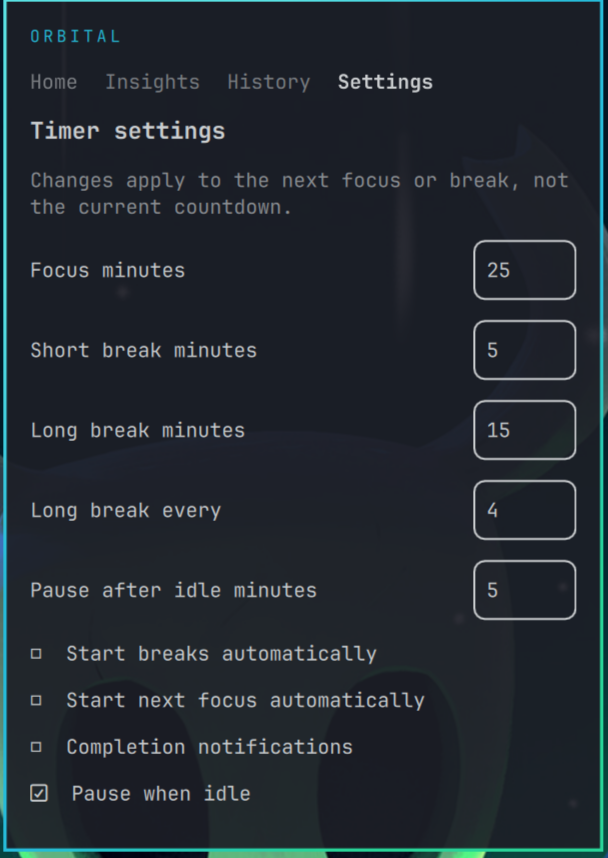

# Orbital

Orbital is a local activity timer for the built-in Omarchy bar. Create recurring activities, select one, and track real active time with a focus countdown or stopwatch.

Repository: https://github.com/rcode010/omarchy-orbital

This repository is under active development. The current build provides activity creation, selection, renaming, color/icon edits, archiving, restoring, and safe deletion of unused activities. It also provides a shared timer service, pause and resume, natural focus completion, Finish Early or Finish, Discard, short/long breaks, durable SQLite sessions, saved Today totals by activity, an Add Missed Time form, paged History with correction and deletion, and Today/Day/Week/Month/Year Insights. Timer, notification, and idle preferences, plus local backup and restore controls, are available in Settings. Full accessibility and live Omarchy verification are still in progress. Do not treat this build as a stable 1.0 release.

## Requirements

- Omarchy 4.x with the built-in Quickshell bar. Development currently targets Omarchy 4.0.6 and Quickshell 0.3.2.
- Python 3 with its standard-library `sqlite3` module.

The plugin ID is `io.github.rcode010.omarchy-orbital`. Its service owns the timer and is shared by bar widgets on all monitors. The panel closes without stopping the service. The helper runs only for user actions and a checkpoint every 60 seconds while tracking; the display tick does not write to SQLite.

Database requests are serialized. If a helper call exceeds 30 seconds, the panel stops it, clears queued actions, and shows a **Refresh state** control. Refresh before repeating a timed-out action because the database may have completed the write before the helper stopped.

Activity names are limited to 80 characters, and the current data protocol caps a library at 500 activities so UI responses remain bounded.

Choose a color before adding a new activity, or select an activity and choose **Manage selected** to edit its name, icon, and color or archive it. The selected swatch has a check mark and a keyboard-accessible label. Enable **Show archived** to restore an archived activity. Deletion requires a second click and is refused when the activity has saved history; archiving keeps that history intact.

Add Missed Time accepts a local start date/time and either a duration in whole minutes or an optional local end time, plus an optional note. The end time takes precedence when provided. Future spans are refused. Overlaps with previously saved time require the explicit **Allow overlap** choice. Manual entries do not change a running timer. History shows bounded 20-row pages with Older and Newer navigation, displays each entry's exact saved duration, mode, source, and note, and can filter by any activity, including archived ones, and an inclusive local-calendar range. It supports corrections and confirmed deletion. A session crossing midnight appears in either calendar day it touches. Correcting a measured session's start or duration replaces its original active segments with one corrected interval; the source is labeled `corrected`.

Insights uses the current system time zone at query time. Weeks start on Monday. Day charts have 23 or 25 hourly bars when daylight saving changes the length of that day; Week and Month use daily bars, and Year uses monthly bars. Every chart value comes from saved session segments, and **Show chart values** provides a text list. The selected activity also shows its saved lifetime total, including when the current period is empty, with a link to its History entries.

## Development checkout

Validate the checkout with `omarchy plugin validate .` and run the backend tests with `PYTHONDONTWRITEBYTECODE=1 python3 -m unittest discover -s tests -v`.

Run a temporary 50,000-session benchmark with `PYTHONDONTWRITEBYTECODE=1 python3 scripts/benchmark_reports.py`. On an Intel Core i9-14900HX with Python 3.14.8 and SQLite 3.54.0, the 2026-11-08 run reported 280.8 ms cold and 280.6 ms warm for the annual report including one selected activity's lifetime total, and 0.3 ms for a filtered 20-row History page. The script creates a fresh temporary database, inserts 50,000 measured sessions and segments, checks that chart points reconcile with the total, and times the report and History reads. These numbers measure only helper queries and aggregation, not panel open time or shell CPU/memory delta.

When the Omarchy shell is running, install a local Git checkout with `omarchy plugin add /path/to/omarchy-orbital --enable`. Omarchy copies the committed files into its plugin directory. Update that installed checkout with `omarchy plugin update io.github.rcode010.omarchy-orbital --yes` after committing local changes. Remove the plugin with `omarchy plugin remove io.github.rcode010.omarchy-orbital --yes`. The plugin runs inside the user's shell process with the user's permissions, so review code before enabling it. Removal deletes the installed plugin checkout, while the SQLite database remains in the separate XDG data directory.

No package installation, network service, account, or telemetry is required by Orbital.

Orbital is licensed under the MIT License. See [LICENSE](LICENSE).

## Data and recovery

Orbital stores `orbital.sqlite3` under `$XDG_DATA_HOME/io.github.rcode010.omarchy-orbital/`, or `~/.local/share/io.github.rcode010.omarchy-orbital/` when `XDG_DATA_HOME` is unset. The directory and database are restricted to the user. Normal plugin removal does not delete this directory.

Settings can create a restorable `.sqlite3` snapshot or a readable JSON export in the `backups/` subdirectory. Restore accepts a listed Orbital snapshot of the current schema, checks its integrity and references, requires an idle timer, and creates a `pre-restore` snapshot of current data before replacement. Copy an Orbital `.sqlite3` snapshot from another machine into that `backups/` directory to make it available in the restore list. JSON exports are for inspection or external processing; restore uses the SQLite snapshots. See the [export format](docs/export-format.md) for the fields and restore contract. Keep separate copies outside this data directory if you need protection against disk loss.

The timer uses Linux monotonic time for measured active intervals. A restart or crash pauses the session at its last verified checkpoint, normally up to a minute earlier while continuously running, and potentially earlier if a checkpoint failed. This conservative recovery avoids counting unverified downtime. The current session can then be resumed, finished, or discarded. Paused time and system suspend do not advance measured active time.

The bar updates about once a second using a display estimate. A wall-clock jump or resume from suspend can advance that estimate by at most two seconds per display tick; the next helper result replaces it with measured monotonic time. Display updates never write sessions or decide their recorded duration.

By default, Orbital pauses when the compositor reports five minutes of inactivity and removes that idle window from the recorded work segments, including across recovery checkpoints. It uses Quickshell's event-driven `IdleMonitor` with inhibitors respected. The timeout can be changed or idle pausing disabled in Settings. Once paused, the user resumes deliberately; activity on the desktop does not silently restart work. This behavior still needs a live compositor smoke test.

The default cycle is 25 minutes of focus, then a 5-minute short break, with a 15-minute long break after four naturally completed focus sessions. Settings can change those values and independently enable automatic start of breaks and of the next focus session. Break time never enters activity totals. Finish Early skips the break and returns to idle without automatic transitions. A break can be started, paused, resumed, or skipped from the panel. Changes to a running countdown apply to later sessions.

When enabled, completion notifications use `notify-send` with argument-array execution. Notification failures do not change saved timer state. They are issued by the single shared service only after a successful natural completion; Finish Early does not notify about a break.

The stored session rows include UTC start/end times and active seconds. New measured sessions also store their active work segments. Today totals split those segments at local midnight using the system time zone, including daylight-saving changes, and exclude pauses. Sessions saved by older development builds have no segments; their daily attribution is estimated proportionally across the recorded start/end interval. If the system clock changes substantially during a segment, Orbital anchors that segment to its start time and measured monotonic duration to avoid allocating phantom hours.

## Current keyboard behavior

Press Escape to close the panel. Ctrl+1, Ctrl+2, Ctrl+3, and Ctrl+4 open Home, Insights, History, and Settings. Space starts, pauses, or resumes the current focus, stopwatch, or break phase. F finishes the current work session. Tab reaches the timer buttons, visible activity rows, chart bars, text fields, and text actions; Enter or Space activates a focused action. Enter adds a new activity from its name field. Live focus-order and screen-reader checks remain before 1.0.

## Development status

The committed checkout has passed automated storage, timer display, and manifest checks. Live testing on 2026-11-09 covered page rendering, keyboard shortcuts, a disposable stopwatch run, removal and data survival, a second bar instance on a temporary headless output, and short shell performance samples. A privacy-safe screenshot is included above. Focus and break completion, notifications, idle behavior, screen reader inspection, and two physical displays remain open. No stable public release has been published.
